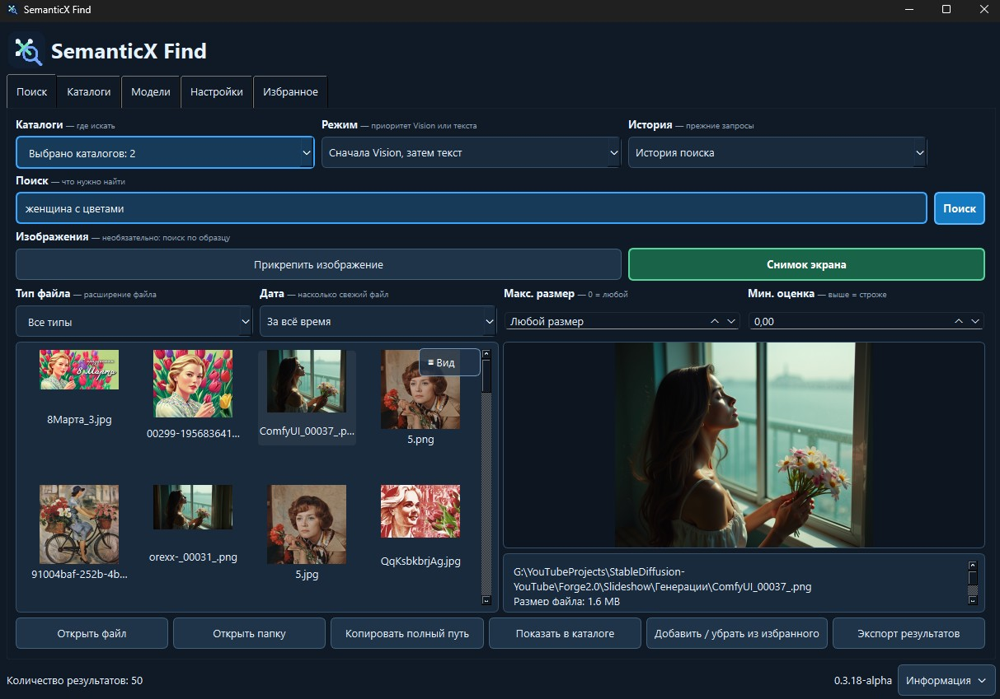

<a id="languages"></a>
**[🇬🇧 English](#english) | [🇷🇺 Русский](#russian)**

---

<a id="english"></a>
## 🇬🇧 English

# 🔎 SemanticX Find



**SemanticX Find** is a local Windows desktop application for semantic file search. It combines text search, EmbeddingGemma 2 embeddings, visual image search, OCR, ComfyUI workflow analysis, catalog filters, favorites, thumbnails, and drag-and-drop file export.

The application works locally. Search queries, indexed files, and attached images are not sent to cloud services. Internet access is used only during installation and model downloads.

### ✨ Main features

- Semantic and lexical search across one or multiple folders.
- Visual search for PNG, JPG, JPEG, and WebP images.
- OCR for text contained in attached images and screenshots.
- Dedicated parsing of ComfyUI workflows, nodes, models, LoRAs, UNets, and VAEs.
- Incremental indexing: unchanged ready files are skipped.
- Search by text, image, or configurable Vision/text priority.
- File-type, modification-date, size, catalog, and minimum-score filters.
- List and thumbnail-grid result views with large image previews.
- Favorites, search history, result export, context menus, and drag-and-drop to other applications.
- English, Russian, French, and Spanish interfaces.
- Performance presets for different RAM and VRAM capacities.

### 💻 System requirements

- Windows 10 or Windows 11, 64-bit.
- At least 8 GB RAM; 32 GB or more is recommended for large catalogs.
- An NVIDIA GPU is optional. CUDA is selected automatically when `nvidia-smi` is available; otherwise the CPU build of PyTorch is installed.
- Approximately 8 GB of free disk space for Python, libraries, models, and caches. Search indexes require additional space depending on catalog size.
- Internet connection during installation.

### 📦 Installation

1. Download or clone this repository.
2. Run `Setup.bat`.
3. Wait while portable Python, PyTorch, application libraries, EmbeddingGemma 2, and OCR models are downloaded and verified.
4. Run `RUN.bat`.

No system-wide Python installation is required. Everything is installed inside the project folder.

To install only the runtime and libraries without downloading models, run the following command in PowerShell:

```powershell
powershell -ExecutionPolicy Bypass -File .\Setup.ps1 -SkipModels
```

Models can be downloaded later from the **Models** tab.

### 🚀 First use

1. Open **Settings** and select the compute device if necessary. English is the default interface language.
2. New installations use the `gemma` search engine with Vision and OCR enabled by default. You can change these options under **Settings**.
3. Open **Catalogs**, add a folder, and configure its indexed file types.
4. Enable visual indexing for catalogs that contain images.
5. Click **Update index**. Use **Rebuild index** only after changing the model, vector dimensions, or visual-indexing mode.
6. Open **Search**, select one or more catalogs, enter a query, and click **Search**.

### ⚙️ Performance presets

| Preset | Indexing threads | Embedding batch | Preparation queue | Suggested memory |
|---|---:|---:|---:|---|
| Minimum | 2 | 32 | 16 | 8–16 GB RAM, up to 6 GB VRAM |
| Basic | 4 | 64 | 32 | 16–32 GB RAM, 6–8 GB VRAM |
| Balanced | 8 | 128 | 64 | 32–64 GB RAM, 8–16 GB VRAM |
| High | 16 | 256 | 128 | 64 GB RAM, 16–24 GB VRAM |
| Maximum | 32 | 512 | 256 | 64+ GB RAM, 24+ GB VRAM |

The **Basic** preset is selected by default for a conservative first start.

If a CUDA embedding batch is too large, SemanticX Find automatically reduces it. Multithreaded indexing speed can also be limited by CPU and storage performance.

### 🛠️ Development and testing

The portable environment created by `Setup.bat` can also run the test suite after installing pytest:

```powershell
.\runtime\python.exe -m pip install pytest
.\runtime\python.exe -m pytest -q
```

Run the application directly through Python:

```powershell
.\runtime\python.exe run.py
```

Useful CLI commands:

```powershell
.\runtime\python.exe -m semanticx.cli download-model
.\runtime\python.exe -m semanticx.cli index C:\path\to\catalog
.\runtime\python.exe -m semanticx.cli search C:\path\to\catalog --query "upscale image"
```

### 🔐 Privacy and local data

The following folders are created locally and excluded from Git:

- `runtime/` — portable Python and installed packages;
- `models/` — downloaded embedding and OCR models;
- `indexes/` and `.semantic_index/` — search indexes;
- `cache/`, `logs/`, and `temp/` — transient application data;
- `config/` — local user settings and catalog configuration.

Third-party dependency information is available in [`docs/THIRD_PARTY.md`](docs/THIRD_PARTY.md).

[⬆ Back to language selection](#languages)

---

<a id="russian"></a>
## 🇷🇺 Русский

# 🔎 SemanticX Find


**SemanticX Find** — локальное настольное приложение для Windows, предназначенное для смыслового поиска файлов. Оно объединяет текстовый поиск, эмбеддинги EmbeddingGemma 2, визуальный поиск изображений, OCR, анализ workflow ComfyUI, фильтры каталогов, избранное, миниатюры и перетаскивание найденных файлов в другие приложения.

Приложение работает локально. Поисковые запросы, индексируемые файлы и прикреплённые изображения не отправляются в облачные сервисы. Интернет требуется только во время установки и скачивания моделей.

### ✨ Основные возможности

- Смысловой и лексический поиск в одном или нескольких каталогах.
- Визуальный поиск изображений PNG, JPG, JPEG и WebP.
- Распознавание текста на прикреплённых изображениях и снимках экрана с помощью OCR.
- Специализированный анализ workflow ComfyUI, узлов, моделей, LoRA, UNet и VAE.
- Инкрементальная индексация: неизменённые и уже готовые файлы пропускаются.
- Поиск по тексту, изображению или с настраиваемым приоритетом Vision и текста.
- Фильтры по типу файла, дате изменения, размеру, каталогу и минимальной оценке.
- Просмотр результатов списком или сеткой миниатюр с крупным предпросмотром.
- Избранное, история поиска, экспорт результатов, контекстные меню и drag-and-drop в другие приложения.
- Интерфейс на английском, русском, французском и испанском языках.
- Пресеты производительности для разного объёма оперативной и видеопамяти.

### 💻 Системные требования

- Windows 10 или Windows 11, 64-bit.
- Не менее 8 ГБ оперативной памяти; для больших каталогов рекомендуется 32 ГБ и более.
- Видеокарта NVIDIA необязательна. CUDA выбирается автоматически при обнаружении `nvidia-smi`; в остальных случаях устанавливается CPU-версия PyTorch.
- Около 8 ГБ свободного места для Python, библиотек, моделей и кэша. Для поисковых индексов потребуется дополнительное место, зависящее от размера каталогов.
- Подключение к интернету во время установки.

### 📦 Установка

1. Скачайте или клонируйте этот репозиторий.
2. Запустите `Setup.bat`.
3. Дождитесь скачивания и проверки переносимого Python, PyTorch, библиотек приложения, EmbeddingGemma 2 и моделей OCR.
4. Запустите `RUN.bat`.

Устанавливать Python в систему не требуется. Всё необходимое размещается внутри папки проекта.

Чтобы установить только среду выполнения и библиотеки, не скачивая модели, выполните в PowerShell:

```powershell
powershell -ExecutionPolicy Bypass -File .\Setup.ps1 -SkipModels
```

Позже модели можно скачать на вкладке **Модели**.

### 🚀 Первый запуск

1. Откройте вкладку **Настройки** и при необходимости выберите вычислительное устройство. По умолчанию интерфейс запускается на английском языке.
2. В новой установке используется движок `gemma`, а Vision и OCR включены по умолчанию. Эти параметры можно изменить на вкладке **Настройки**.
3. Откройте вкладку **Каталоги**, добавьте папку и выберите типы индексируемых файлов.
4. Для каталогов с изображениями включите визуальную индексацию.
5. Нажмите **Обновить индекс**. Используйте **Пересоздать индекс** только после смены модели, размерности векторов или режима визуальной индексации.
6. Перейдите на вкладку **Поиск**, выберите один или несколько каталогов, введите запрос и нажмите **Поиск**.

### ⚙️ Пресеты производительности

| Пресет | Потоки индексации | Размер пакета | Очередь подготовки | Рекомендуемая память |
|---|---:|---:|---:|---|
| Минимальный | 2 | 32 | 16 | 8–16 ГБ RAM, до 6 ГБ VRAM |
| Базовый | 4 | 64 | 32 | 16–32 ГБ RAM, 6–8 ГБ VRAM |
| Сбалансированный | 8 | 128 | 64 | 32–64 ГБ RAM, 8–16 ГБ VRAM |
| Высокий | 16 | 256 | 128 | 64 ГБ RAM, 16–24 ГБ VRAM |
| Максимальный | 32 | 512 | 256 | 64+ ГБ RAM, 24+ ГБ VRAM |

Для безопасного первого запуска по умолчанию выбран пресет **Базовый**.

Если размер CUDA-пакета окажется слишком большим, SemanticX Find автоматически уменьшит его. Скорость многопоточной индексации также может ограничиваться производительностью процессора и накопителя.

### 🛠️ Разработка и тестирование

Переносимую среду, созданную `Setup.bat`, можно использовать для запуска тестов после установки pytest:

```powershell
.\runtime\python.exe -m pip install pytest
.\runtime\python.exe -m pytest -q
```

Запуск приложения непосредственно через Python:

```powershell
.\runtime\python.exe run.py
```

Полезные команды CLI:

```powershell
.\runtime\python.exe -m semanticx.cli download-model
.\runtime\python.exe -m semanticx.cli index C:\path\to\catalog
.\runtime\python.exe -m semanticx.cli search C:\path\to\catalog --query "upscale image"
```

### 🔐 Конфиденциальность и локальные данные

Следующие папки создаются локально и исключены из Git:

- `runtime/` — переносимый Python и установленные пакеты;
- `models/` — скачанные модели эмбеддингов и OCR;
- `indexes/` и `.semantic_index/` — поисковые индексы;
- `cache/`, `logs/` и `temp/` — временные данные приложения;
- `config/` — пользовательские настройки и конфигурация каталогов.

Сведения о сторонних компонентах находятся в файле [`docs/THIRD_PARTY.md`](docs/THIRD_PARTY.md).

[⬆ Вернуться к выбору языка](#languages)
